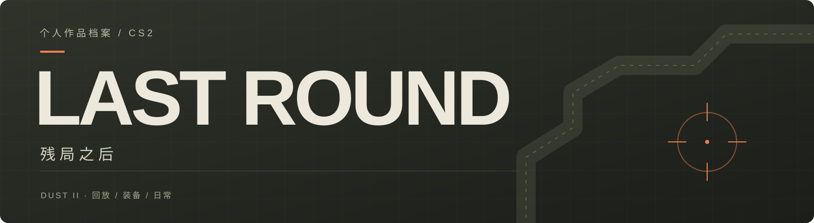

  

<h1 align="center">LAST ROUND · 在线站点</h1>

一个 CS 玩家的实战回放、装备与日常。

  <a href="https://927242768-dotcom.github.io/">打开网站</a> ·
  <a href="https://927242768-dotcom.github.io/admin/">作品后台</a> ·
  <a href="https://github.com/927242768-dotcom/last-round-cs">完整源码</a> ·
  <a href="https://github.com/927242768-dotcom/last-round-cs/tree/main/docs">维护文档</a>

---

## 这个仓库保存什么？

这是 **GitHub Pages 发布仓库**，保存当前网站使用的页面、素材和作品数据。源码开发、构建工具及完整文档集中在 **[last-round-cs](https://github.com/927242768-dotcom/last-round-cs)**。

| 内容 | 位置 | 说明 |
| --- | --- | --- |
| 网站入口 | `index.html` | 当前公开网页 |
| 作品后台 | `admin/`、`admin.html` | 通过本站专用 GitHub 令牌管理作品 |
| 已发布作品 | `api/works` | 前台读取的公开列表 |
| 全部作品记录 | `data/works.json` | 包含草稿，供后台维护 |
| 人物与场景 | `art/` | 角色追视图和场景插画 |
| 录屏与上传 | `media/` | 实战回放、封面和上传素材 |
| 字体及许可证 | `fonts/` | Barlow Condensed 与 IBM Plex Mono |
| 仓库说明 | `docs/` | 发布维护、素材与版权索引 |

根目录的页面和脚本是线上运行所需的发布文件，保持现有路径可确保人物追视、视频回放与后台引用正常。

## 日常更新作品

进入[作品后台](https://927242768-dotcom.github.io/admin/)，按页面说明使用仅授权本站仓库 Contents 读写权限的 GitHub 令牌登录。后台支持新增、编辑、排序、上架、下架、删除和素材上传。

令牌只保留在当前页面内存，刷新或退出后清除。保存后等待 GitHub Pages 完成发布；单个上传文件上限为 **25 MiB**，也可填写视频直链。

**本仓库及其文件是公开内容。** 草稿只是不在前台展示，不能用于保存私密内容。

## 维护代码与发布

请在[源码仓库](https://github.com/927242768-dotcom/last-round-cs)修改页面或构建工具。更新发布仓库前，先同步最新作品记录，保留 `data/works.json`、`api/works` 和 `media/uploads/`。

- [发布仓库维护说明](docs/maintenance.md)
- [完整部署流程](https://github.com/927242768-dotcom/last-round-cs/blob/main/docs/deployment.md)
- [作品管理说明](https://github.com/927242768-dotcom/last-round-cs/blob/main/docs/content-management.md)
- [问题反馈](https://github.com/927242768-dotcom/last-round-cs/issues/new/choose)

## 版权与素材

本仓库未授予开源使用许可。第三方字体保留各自许可证，游戏相关内容的权利归相应权利人所有。请参阅 [LICENSE](LICENSE) 和[素材说明](docs/credits.md)。
